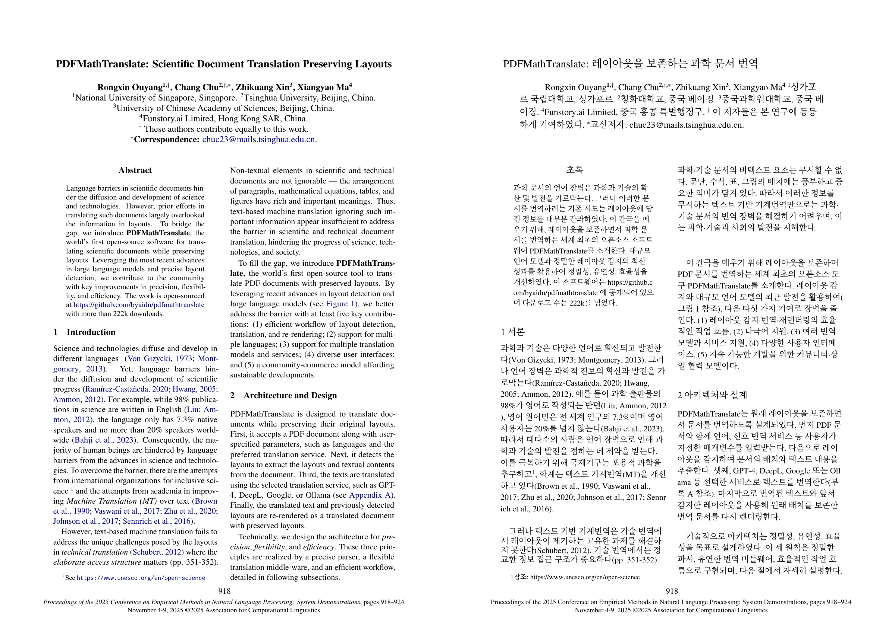
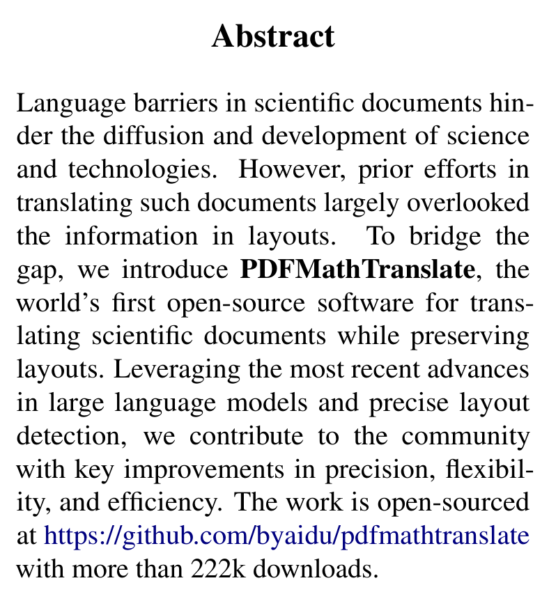
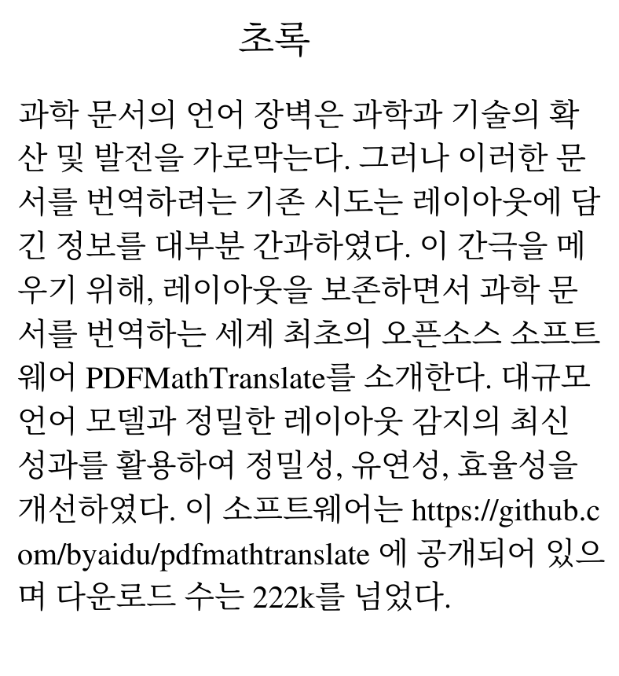
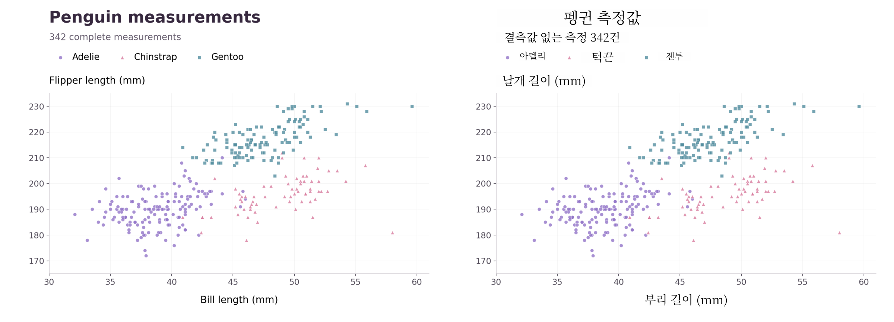
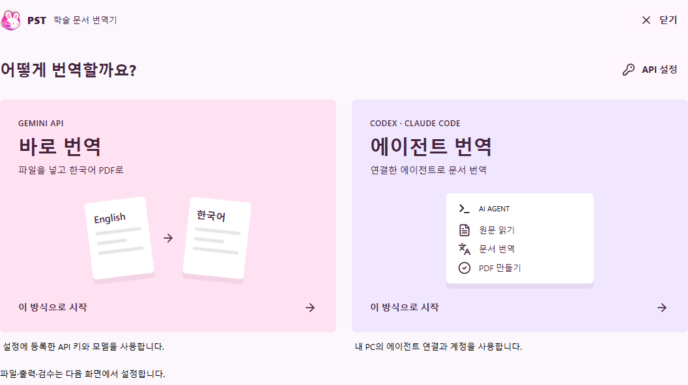

# 실제 결과로 보는 Paper Study Translator

[README로 돌아가기](../README.md) · [Windows 다운로드](https://github.com/anfyznvhs3-droid/paper-study-translator/releases/latest)

이 자료는 공개 논문과 공개 측정 데이터를 앱의 PDF 처리 경로에 넣어 만든 설명 자료입니다.
PDF 이미지는 출력 파일을 직접 렌더링했습니다. 글자를 합성하거나 결과 위에 다시 그리지 않았습니다.

## 논문 원문과 한국어를 나란히

왼쪽은 원문, 오른쪽은 번역문이며 **둘이 하나의 PDF 페이지**입니다.
원문의 2단 배치, 인용, 각주를 함께 보면서 읽을 수 있습니다.
이 예시의 PDF 크기는 1190.552 × 841.890 pt이고 페이지 수는 1입니다.

[DUAL PDF 다운로드](https://github.com/anfyznvhs3-droid/paper-study-translator/releases/download/v0.1.0/paper-dual-example.pdf)
· [원문 논문](https://aclanthology.org/2025.emnlp-demos.71/)

### 초록 확대

  
  

본문의 `98%`, `7.3%`, `20%`가 한국어 PDF에도 남아 있는지 확인했습니다.
페이지 하단 학술대회 서지정보는 에이전트 번역 맵에서 원문 그대로 유지했습니다.
긴 URL과 인용에는 줄바꿈이 생기며, 번역문 길이에 따라 원문과 행 수가 달라집니다.
특정 수치의 보존을 확인한 예시이며, 모든 인용·수식·번역 의미를 자동 검증했다는 뜻은 아닙니다.

출처: Rongxin Ouyang, Chang Chu, Zhikuang Xin, Xiangyao Ma (2025).
*PDFMathTranslate: Scientific Document Translation Preserving Layouts*.
EMNLP System Demonstrations, pp. 918–924, [DOI: 10.18653/v1/2025.emnlp-demos.71](https://doi.org/10.18653/v1/2025.emnlp-demos.71).
첫 페이지(p. 918)를 발췌·한국어 번역했습니다. [CC BY 4.0](https://creativecommons.org/licenses/by/4.0/).
논문 본문에 있는 다운로드 수와 기능 주장은 원문 논문에 대한 설명입니다.

## 이미지 차트의 OCR 번역

이 차트는 palmerpenguins의 실제 측정값으로 만든 소개용 시각화입니다.
344건 중 부리 길이와 날개 길이가 모두 있는 342건을 그렸습니다.
차트를 PNG 한 장으로 PDF에 넣었으므로 입력에는 선택 가능한 텍스트가 없습니다.

앱의 `image_ocr.py`가 Tesseract로 글자를 인식하고, 에이전트 번역을 받은 뒤,
한국어 글자를 PDF에 배치했습니다. 이어서 `final_output.py`가 좌우 DUAL PDF를 생성했습니다.

| 이미지에서 인식한 원문 | 실제 출력 |
| --- | --- |
| Penguin measurements | 펭귄 측정값 |
| 342 complete measurements | 결측값 없는 측정 342건 |
| Adelie / Chinstrap / Gentoo | 아델리 / 턱끈 / 젠투 |
| Flipper length (mm) | 날개 길이 (mm) |
| Bill length (mm) | 부리 길이 (mm) |

7개 라벨의 한국어 배치를 확인했습니다. 산점도 내부 영역을 같은 해상도로 렌더링해 비교했을 때
픽셀이 동일했습니다. 이는 이 차트의 점·눈금선 영역에 대한 확인이며 다른 자료의 보존 여부는 별도 확인이 필요합니다.

[OCR DUAL PDF 다운로드](https://github.com/anfyznvhs3-droid/paper-study-translator/releases/download/v0.1.0/ocr-chart-dual-example.pdf)

### 이 예시에서도 검수가 필요한 이유

Tesseract가 일부 점과 삼각형을 `an`, `ee`, `AA AA` 같은 글자로 오인했습니다.
이 구간은 번역 맵에서 그대로 두어 그림을 보존했고, 앱은 불확실 인식 묶음을 포함해
**미해결 검수 기록 15건**을 남겼습니다. 따라서 “라벨 7곳이 번역됨”과 “검수가 모두 끝남”은 다릅니다.
이 예시는 고해상도·흰 배경·수평 글씨를 사용했습니다. 회전된 축 이름, 작은 스캔,
사진 위 글씨까지 같은 결과를 낸다고 일반화할 수 없습니다.

데이터: Kristen Gorman / Palmer Station LTER에서 수집한
[palmerpenguins](https://allisonhorst.github.io/palmerpenguins/) 데이터.
패키지 저자: Allison Horst, Alison Hill, Kristen Gorman.
데이터 라이선스: [CC0](https://github.com/allisonhorst/palmerpenguins/blob/main/LICENSE.md).
개별 관측값과 점 위치는 임의로 만들거나 수정하지 않았습니다.

## 앱에서 사용하는 흐름

1. **바로 번역** 또는 **에이전트 번역**을 선택합니다.
2. 파일/폴더를 등록하고 **원문 + 한국어 · PDF 좌우 비교**를 선택합니다.
3. 번역 후 후보를 확인하려면 검수를 ON으로 둡니다.
4. 번역을 실행한 뒤 결과 PDF를 열어 원문과 비교합니다.

시작 화면은 v0.1.0 프로덕션 프런트엔드를 격리된 Tauri IPC 미리보기 환경에서 캡처했습니다.
실제 사용자의 API 키, 파일 경로, 작업 기록은 포함하지 않았습니다.

## 생성 조건과 확인 범위

| 항목 | 조건 |
| --- | --- |
| 앱 코드 | v0.1.0, `184c074` |
| 번역 | 이 설명 자료를 만든 Codex 에이전트의 고정 번역 맵 |
| 렌더링 | 앱 `high_level.translate(service="offline")`, OCR·최종 DUAL 처리 포함 |
| OCR | Tesseract `5.4.0.20240606`, English |
| 데이터 차트 | Matplotlib `3.10.8`, 180 dpi PNG |
| 문서 실행 환경 | Python 3.12, Windows x64, 배포본 글꼴·ONNX 모델 |
| 네트워크 | 공개 원자료 다운로드 후 렌더링 단계에서 차단 |
| 확인 | PDF 페이지 수·크기, 한국어 라벨, 선택한 수치, 차트 영역 픽셀 비교, 직접 이미지 확인 |

고정 번역 맵을 앱에 공급해 재현할 수 있는 결과입니다. Gemini 모델의 품질·속도·요금 측정이나
외부 에이전트 CLI의 로그인·통신 검증은 이 자료의 범위에 포함하지 않습니다.
전체 논문을 번역한 품질 평가도 아닙니다. 샘플의 PDF·PNG·번역 맵은 같은 결과를 가리킵니다.

[재생성 방법과 입력 파일 해시](examples/ATTRIBUTION.md)

## README 구성 참고

2026-10-18에 GitHub 원문과 소개 이미지를 확인했습니다. 스타 수는 조회 당시 값입니다.

| 프로젝트 | 조회 당시 Stars | 참고한 구성 |
| --- | ---: | --- |
| [PDFMathTranslate](https://github.com/PDFMathTranslate/PDFMathTranslate) | 37,623 | 설명 바로 아래 실제 PDF 번역 미리보기 |
| [Docling](https://github.com/docling-project/docling) | 69,029 | 입력과 결과가 드러나는 대표 이미지, 짧은 Quickstart |
| [Stirling-PDF](https://github.com/Stirling-Tools/Stirling-PDF) | 94,396 | 실제 앱 화면을 앞에 배치하고 기능·설치를 간결하게 안내 |

참고 프로젝트의 이미지와 홍보 문구를 복제하지 않았습니다.
이 저장소의 예시는 우리 앱 화면과 위에 출처를 표시한 자료로 새로 생성했습니다.
